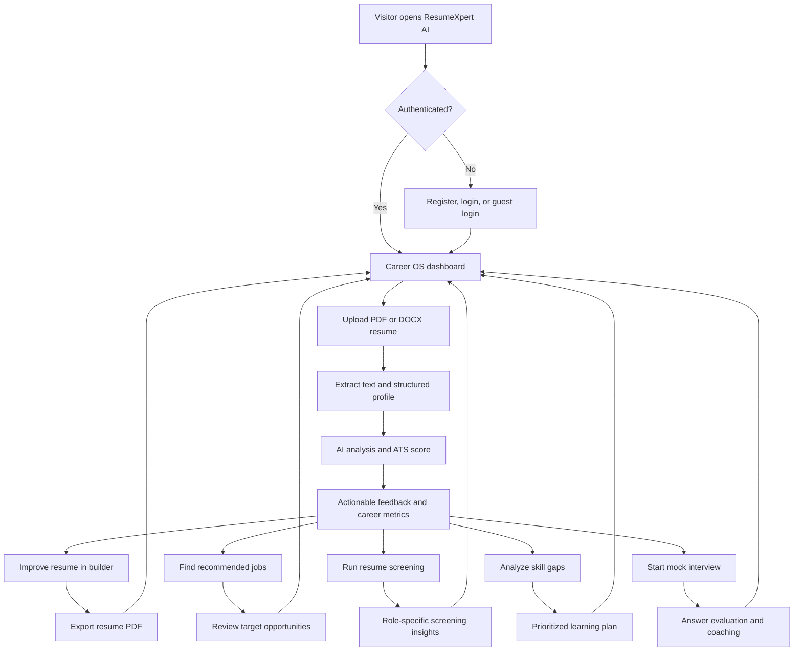
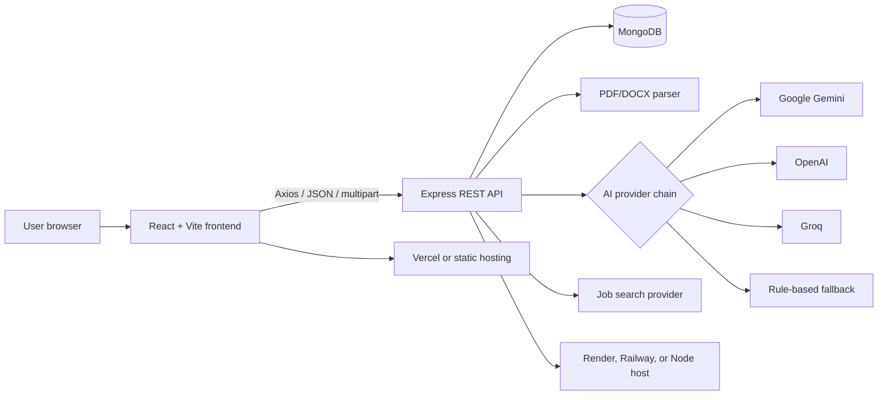

# ResumeXpert AI

[](https://resumexpertai.vercel.app/)
[](./frontend)
[](./backend)
[](LICENSE)

**ResumeXpert AI is an AI-powered Career OS for turning a resume into a practical job-search strategy.** Upload a resume, understand its ATS readiness, improve it with actionable feedback, discover matching roles, identify skill gaps, and practice interviews from one workspace.

> **Live application:** [resumexpertai.vercel.app](https://resumexpertai.vercel.app/)

## Contents

- [What it does](#what-it-does)
- [Product flow](#product-flow)
- [Architecture](#architecture)
- [Feature overview](#feature-overview)
- [Technology stack](#technology-stack)
- [Repository structure](#repository-structure)
- [Run locally](#run-locally)
- [Environment variables](#environment-variables)
- [API overview](#api-overview)
- [Deployment](#deployment)
- [Security and reliability](#security-and-reliability)
- [Available scripts](#available-scripts)
- [Troubleshooting](#troubleshooting)
- [Contributing](#contributing)
- [License](#license)

## What it does

ResumeXpert AI combines resume intelligence, job discovery, and interview preparation in a single workflow:

- **Resume intelligence:** Parse PDF and DOCX resumes and extract structured candidate data.
- **ATS analysis:** Evaluate resume quality, identify missing keywords, and surface improvements.
- **Resume builder:** Create and export polished resumes with multiple templates.
- **Job matching:** Search and recommend roles based on a candidate's profile and skills.
- **Interview coaching:** Generate role-aware mock interviews and evaluate submitted answers.
- **Screening and skill gaps:** Compare a profile against a role and prioritize what to learn next.
- **Career analytics:** Track scores, activity, and progress from the dashboard.
- **Guest mode:** Explore the product with the guest-login experience before creating an account.

## Product flow



## Architecture



The repository intentionally keeps the UI and API in separate application folders so each service can be developed and deployed independently. The backend can also serve the built frontend when `frontend/dist` is present.

## Feature overview

| Area | Included capabilities |
| --- | --- |
| Authentication | JWT sessions, bcrypt password hashing, guest login, profile and password management |
| Resume workspace | PDF/DOCX upload, parsing, saved resumes, update and delete operations |
| ATS analysis | AI-generated scoring, strengths, weaknesses, keyword guidance, and improvement suggestions |
| Resume builder | Multiple templates, live preview, and client-side PDF export |
| Job search | Search, recommendations, public job reads, and recruiter/admin management routes |
| Interview coach | AI-generated questions, answer submission, completion, and feedback |
| Screening | Resume screening and role-based skill-gap analysis |
| Dashboard | Candidate statistics, feedback history, and admin statistics |
| UI | Responsive React SPA, protected routes, animations, charts, and 3D visual elements |

## Technology stack

### Frontend

- React 18 and React Router 6
- Vite 5
- Tailwind CSS and custom design tokens
- Axios for API communication
- Recharts for analytics
- Framer Motion, GSAP, and OGL/Three.js for motion and visual effects
- `html2pdf.js` for resume export

### Backend

- Node.js 18+ and Express 4
- MongoDB with Mongoose 8
- JWT authentication and bcryptjs password hashing
- `pdf-parse` and `mammoth` for resume extraction
- Gemini, OpenAI, and Groq integrations with graceful fallback data
- Helmet, CORS, rate limiting, and Morgan request logging

## Repository structure

```text
.
├── backend/
│   ├── config/                 # Database connection
│   ├── controllers/            # Request and business logic
│   ├── middleware/             # Auth, uploads, errors, and 404 handling
│   ├── models/                 # Mongoose schemas
│   ├── routes/                 # REST route definitions
│   ├── utils/                  # AI service, parsers, tokens, job aggregation
│   ├── .env.example
│   ├── package.json
│   └── server.js               # API entry point
├── frontend/
│   ├── public/                 # Static assets
│   ├── src/
│   │   ├── components/         # Shared UI and visual components
│   │   ├── context/            # Authentication state
│   │   ├── pages/              # Product screens
│   │   ├── services/           # Axios API layer
│   │   └── App.jsx             # Application routing
│   ├── .env.example
│   └── package.json
└── README.md
```

## Run locally

### Prerequisites

- Node.js 18 or newer
- npm 9 or newer
- MongoDB locally or a MongoDB Atlas cluster
- At least one AI provider key for live AI responses

### 1. Clone and install

```bash
git clone https://github.com/Santoshray-27/resumexpert-ai.git
cd resumexpert-ai

cd backend
npm install

cd ../frontend
npm install
cd ..
```

### 2. Configure the backend

```bash
cp backend/.env.example backend/.env
```

Set `MONGODB_URI`, `JWT_SECRET`, and at least `GEMINI_API_KEY` in `backend/.env`. Add the optional provider and job-search keys when those integrations are needed.

### 3. Configure the frontend

```bash
cp frontend/.env.example frontend/.env
```

For local development, the default value is normally correct:

```env
VITE_API_URL=http://localhost:5000/api
```

### 4. Start both applications

Use two terminals:

```bash
# Terminal 1
cd backend
npm run dev
```

```bash
# Terminal 2
cd frontend
npm run dev
```

Open [http://localhost:5173](http://localhost:5173). The API health check is available at [http://localhost:5000/api/health](http://localhost:5000/api/health).

## Environment variables

### Backend (`backend/.env`)

| Variable | Required | Purpose |
| --- | --- | --- |
| `PORT` | No | API port; defaults to `5000` |
| `NODE_ENV` | No | Runtime mode, usually `development` or `production` |
| `MONGODB_URI` | Yes | MongoDB connection string |
| `JWT_SECRET` | Yes | Secret used to sign access tokens |
| `JWT_EXPIRE` | No | Token lifetime, such as `7d` |
| `GEMINI_API_KEY` | Recommended | Primary AI provider |
| `OPENAI_API_KEY` | No | Secondary AI provider |
| `GROQ_API_KEY` | No | Tertiary AI provider |
| `RAPIDAPI_KEY` | No | Job-search integration key |
| `FRONTEND_URL` | Yes in production | Allowed frontend origin for CORS |

### Frontend (`frontend/.env`)

| Variable | Required | Purpose |
| --- | --- | --- |
| `VITE_API_URL` | Yes | Backend API base URL, including `/api` |

Never commit `.env` files or API keys. Use the supplied `.env.example` files as templates.

## API overview

All API routes are prefixed with `/api`. Protected routes expect a JWT in the `Authorization: Bearer <token>` header.

| Resource | Main endpoints |
| --- | --- |
| Health | `GET /api/health` |
| Auth | `POST /api/auth/register`, `/login`, `/guest-login`; `GET /me`; profile and password updates |
| Resumes | `GET /api/resumes`; `POST /api/resumes/upload`; read, update, and delete by ID |
| Analysis | `POST /api/analysis/analyze/:resumeId`; list and retrieve analyses |
| Jobs | `GET /api/jobs`; `POST /api/jobs/search`; `GET /api/jobs/recommendations` |
| Interviews | `GET /api/interviews`; create sessions, submit answers, and complete sessions |
| Screening | `POST /api/screening/screen`; `POST /api/screening/skill-gap`; resume listing |
| Dashboard | `GET /api/dashboard/stats` |
| Feedback | `POST /api/feedback`; `GET /api/feedback/my` |

AI-heavy routes have a dedicated hourly limit, authentication routes have stricter brute-force protection, and all other API routes use the global rate limiter configured in `backend/server.js`.

## Deployment

### Frontend on Vercel

1. Import the repository into Vercel.
2. Set the project root to `frontend`.
3. Use the Vite preset.
4. Set `VITE_API_URL` to the deployed backend URL ending in `/api`.
5. Build with `npm run build` and serve the generated `dist` directory.

### Backend on Render or Railway

1. Create a Node service connected to this repository.
2. Set the root directory to `backend`.
3. Install with `npm install`.
4. Start with `npm start`.
5. Configure every required variable from `backend/.env.example`.
6. Set `FRONTEND_URL` to the deployed frontend origin.
7. Use `/api/health` as the health-check endpoint.

For a single-host deployment, build the frontend first and run the backend from the repository root context so the backend can serve `frontend/dist`.

## Security and reliability

- Passwords are hashed with bcryptjs and sessions use signed JWTs.
- Helmet applies security headers and the API restricts CORS origins.
- Global, authentication, and AI-specific rate limits reduce abuse and API-credit exhaustion.
- Resume uploads are handled through Multer and parsed server-side.
- AI requests use an ordered Gemini → OpenAI → Groq provider chain.
- If providers are unavailable or return an invalid response, the service uses explicit fallback data instead of blocking the entire product flow.
- Production deployments should use HTTPS, a strong randomly generated `JWT_SECRET`, managed MongoDB credentials, and platform secret storage.

## Available scripts

### Backend

| Command | Description |
| --- | --- |
| `npm run dev` | Start the API with Nodemon |
| `npm start` | Start the API with Node |
| `npm test` | Placeholder test command; automated tests are not currently configured |

### Frontend

| Command | Description |
| --- | --- |
| `npm run dev` | Start the Vite development server on port 5173 |
| `npm run build` | Create a production build |
| `npm run preview` | Preview the production build locally |
| `npm run lint` | Run ESLint with warnings treated as errors |

## Troubleshooting

### Frontend cannot reach the API

Confirm that `frontend/.env` contains the correct `VITE_API_URL`, restart Vite after changing environment variables, and verify that the backend responds at `/api/health`.

### CORS errors in production

Set `FRONTEND_URL` to the exact deployed frontend origin, including the protocol and without a trailing path. Restart the backend after changing it.

### AI analysis uses fallback data

Check that the configured provider key is valid, that the provider is available, and that the backend process loaded the `.env` file. The fallback path is intentional and keeps non-AI parts of the application usable.

### MongoDB connection fails

Verify the connection string, network access rules, database credentials, and that the MongoDB service is running. Atlas deployments must allow the backend host's network access.

## Contributing

1. Create a feature branch from `main`.
2. Keep frontend and backend changes focused and documented.
3. Run `npm run lint` and `npm run build` in `frontend` when changing the UI.
4. Start the backend and verify `/api/health` for API changes.
5. Open a pull request with a concise description, screenshots for visual changes, and setup notes when environment variables change.

## License

This project is released under the [MIT License](LICENSE).

Built to help job seekers move from applications to measurable career growth.
